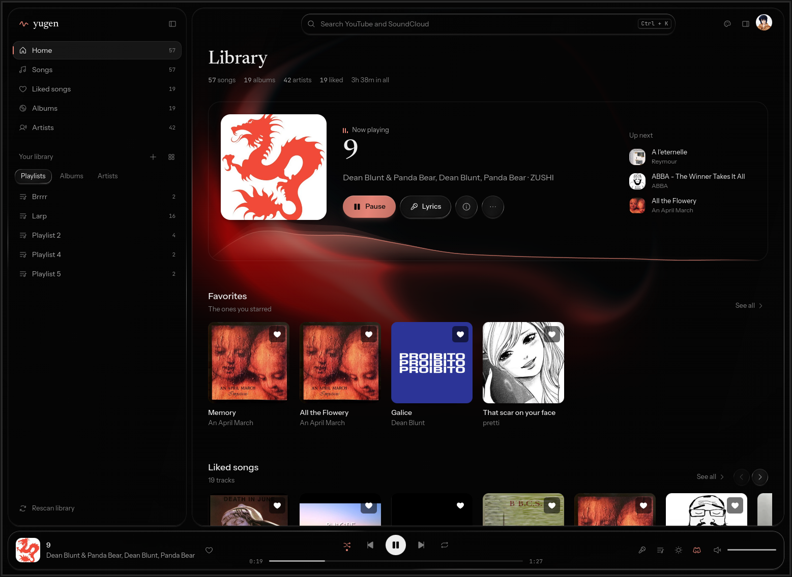
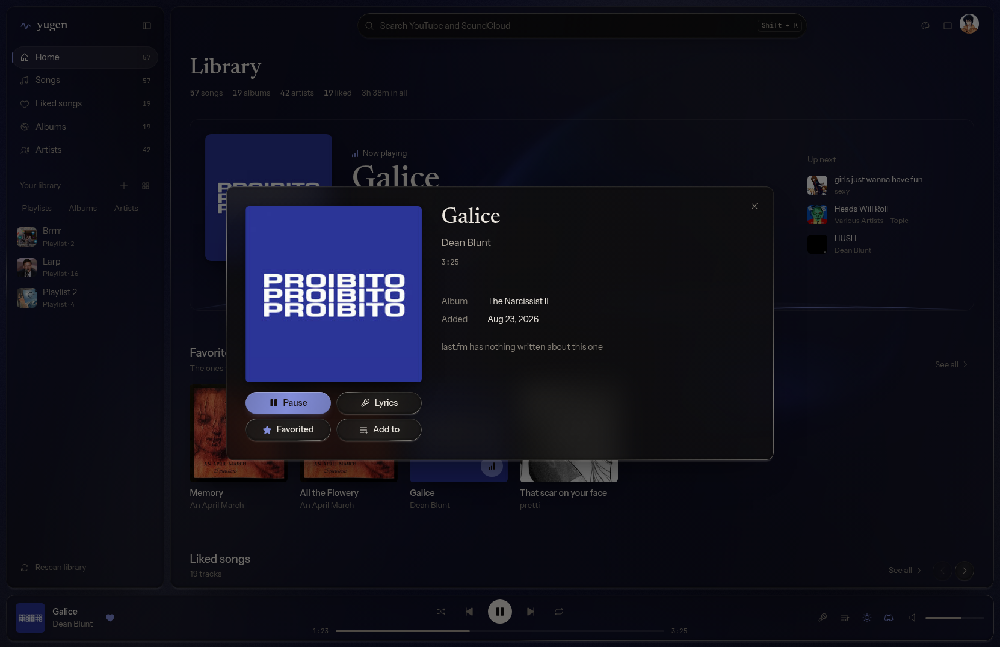

# yugen

<p align="center">
  
</p>

<p align="center">
  
  <br />
  <em>the track modal, with lyrics scrolling along</em>
</p>

<p align="center">
  
  
  <br />
  <em>what last.fm makes of the library, and of the songs you liked</em>
</p>

A desktop music player for Linux. Plays local mp3 files, searches and downloads
tracks from YouTube and SoundCloud through `yt-dlp`, keeps playlists and liked
songs, shows synced lyrics from [lrclib](https://lrclib.net), suggests what to
add next from [last.fm](https://www.last.fm), and tints itself with the cover
art of whatever is playing.

It publishes itself over MPRIS, so the track and the transport show up wherever
the desktop looks for a player — panels and shell dashboards, the lock screen,
`playerctl`, and the media keys.

The backend is C++ — [saucer](https://github.com/saucer/saucer) for the webview,
[miniaudio](https://miniaud.io) for playback, TagLib for metadata. The interface
is React + TypeScript, built into a bundle that is baked straight into the
executable, so the binary is all there is to run.

## Install

This branch is the first alternative interface, built on Qt (QtWebEngine).
`claude/alternative-ui` is where it went on from here. The installer on `master`
(`install.sh`) installs `master`'s own release, the original interface — not
this one — so this branch has builds of its own:

| | |
|---|---|
| **Linux x64** | [`yugen-linux-x86_64.zip`](https://github.com/gal1ce/yugen/releases/download/alternate-ui-2026.10.18/yugen-linux-x86_64.zip) — unzip it anywhere and run `yugen-linux-x86_64/yugen`. Qt, QtWebEngine, `yt-dlp` and `ffmpeg` are inside; nothing needs installing. Needs glibc 2.38 or newer (Ubuntu 24.04+, Debian 13+, Fedora 39+, Arch) and NSS from the system, which any desktop with Firefox or Chromium has. |
| **Windows x64** | [`Yugen-windows-x64.zip`](https://github.com/gal1ce/yugen/releases/download/alternate-ui-windows-preview-2026.10.18/Yugen-windows-x64.zip) — extract it and run `bin/yugen.exe`. Built from `codex/windows-support` as it stood on 2026-10-18, with this interface. A preview: it builds, but has not been run on native Windows yet. |

Or build it yourself from this branch:

```sh
git clone -b codex/alternate-interface https://github.com/gal1ce/yugen.git
```

and follow [Building](#building) below.

### The last.fm key

The library page ends with a shelf of tracks you do not have yet, picked by
last.fm from what you have liked and favourited. That is the one thing here that
needs an api key — a free one from
[last.fm/api/account/create](https://www.last.fm/api/account/create). Everything
else works without it; skipping it only costs that shelf.

There are two ways to give it to yugen. Write the file directly:

```sh
mkdir -p ~/.config/yugen && echo "your-key" > ~/.config/yugen/lastfm_key
```

Or export the key once and start yugen from that same shell — it copies the key
into that file on startup, so it is a one-time thing rather than something to
put in your shell rc:

```sh
export LASTFM_API_KEY="your-key"
yugen
```

An `export` on its own is not enough, because it only lives in the shell that
ran it: yugen started from the desktop launcher, or from your next terminal,
would come up without a key. The file is what carries it across runs, and it is
read first thing at startup, so a key added while yugen is running takes effect
the next time it starts.

Both zips are from 2026-10-18. The Linux one is built with
[`packaging/linux/build-in-container.sh`](packaging/linux/build-in-container.sh),
inside an Ubuntu 24.04 image so the glibc floor stays at 2.38; the Windows one
by the `Windows x64` workflow on `codex/windows-support`.

## Building

Needs CMake 3.10+, a C++23 compiler, `pkg-config`, Node.js, the dev packages for
`taglib`, `libcurl` and `glib2` (for GDBus, which serves the MPRIS interface),
WebKitGTK, and `yt-dlp` + `ffmpeg` on `PATH`. Everything else is fetched by
CMake.

The UI has to be built first — CMake embeds `ui/dist` when it configures and
will not build without it:

```sh
cd ui
npm install
npm run build
cd ..

cmake -B build -G Ninja && cmake --build build
```

After changing the UI, re-run `npm run build` and then `cmake --build build`.

## Running

```sh
./build/yugen
```

Or install it system-wide, which also drops in the desktop entry and icons:

```sh
sudo cmake --install build
```

The music folder comes from the backend's `get_music_dir` binding, which points
at `~/Music` and creates it if it is not there. Playlists, liked songs and the
last.fm key live in `~/.config/yugen/`.

## License

[LICENSE](LICENSE) — MIT
